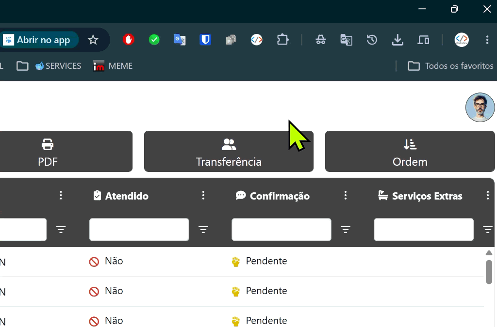

# 🚀 Brandev Inspector (Chrome Extension + Sidecar)

Extensão de produtividade para desenvolvimento web com o **Antigravity IDE**. Permite que você clique em qualquer elemento ou selecione qualquer texto no navegador e abra o arquivo e a linha correspondente diretamente no Antigravity IDE, **sem precisar injetar ou alterar código em nenhum projeto**.

<p align="center">
  
</p>

---

## ⚡ Como Funciona

1. **Extensão (Chrome / Brave / Edge)**:
   - Captura a ação do desenvolvedor (`Alt + Clique` ou menu de contexto).
   - Envia os metadados (texto, tag, ID, classes, URL) para o **Sidecar Local**.
   - Possui **Popup no ícone da extensão** com status em tempo real e botão para iniciar/parar o Sidecar com 1 clique!
2. **Sidecar Local (`sidecar.js` na porta `39999`)**:
   - Identifica automaticamente qual projeto de `S:\DEVELOPER` corresponde à URL acessada (ex: `chuachua.local` -> pasta `CHUACHUA`).
   - Escaneia as views/templates e localiza a linha exata do elemento.
   - Dispara a abertura do arquivo no Antigravity IDE diretamente na linha (`antigravity-ide.cmd -r -g "arquivo:linha"`).

---

## 🛠️ Instalação e Configuração

### 1. Registrar o Protocolo de Inicialização (1 vez só)
- Dê um duplo-clique no arquivo **`registrar-protocolo.bat`**.
- Isso permite que o botão **"▶ Iniciar Sidecar"** no popup do Chrome inicie o servidor em segundo plano de forma 100% silenciosa (sem tela preta).

### 2. Carregar a Extensão no Chrome / Brave / Edge
1. Baixe ou clone este repositório para o seu computador:
   ```bash
   git clone git@github.com:Brandevtech/brandev-inspector.git
   ```
2. Abra o navegador e acerte para: `chrome://extensions` (ou `brave://extensions` / `edge://extensions`).
3. No canto superior direito, ative o **"Modo do desenvolvedor"** (*Developer mode*).
4. Clique em **"Carregar sem compactação"** (*Load unpacked*).
5. Selecione a pasta do repositório clonado.
6. Fixe o ícone do **Brandev Inspector** na barra de ferramentas!

---

## 🎯 Como Usar

### 1. Controlar o Sidecar pelo Ícone da Extensão
- Clique no ícone do **Brandev Inspector** no navegador:
  - Se estiver **OFFLINE**: clique em **"▶ Iniciar Sidecar"** e ele sobe silenciosamente em background!
  - Se estiver **ONLINE**: você pode abrir o dashboard completo ou parar o processo quando quiser.

### 2. Inspetor Visual na Página
- Em qualquer página local (ex: `http://chuachua.local`, `http://localhost/...`), segure **`Alt`**.
- Passe o mouse sobre qualquer elemento (botão, título, modal, card).
- Dê um **Clique com o botão esquerdo (com `Alt` pressionado)**: o Antigravity IDE focará instantaneamente no arquivo e linha daquele elemento!

### 3. Seleção de Texto Livre
- Selecione qualquer trecho de texto ou código na página.
- Clique com o **botão direito** $\rightarrow$ **"Abrir no Antigravity IDE"**.
